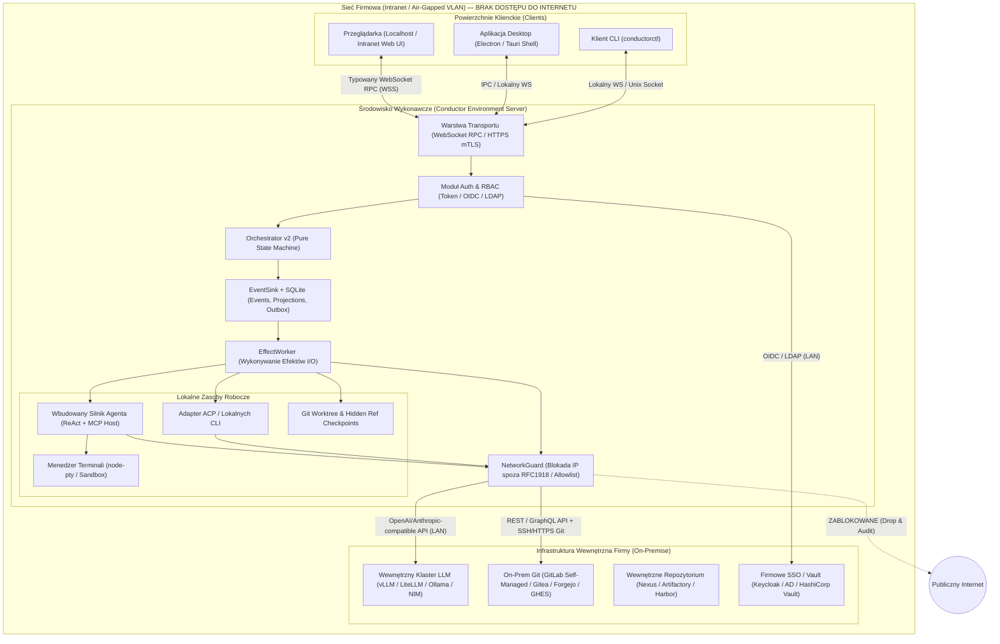
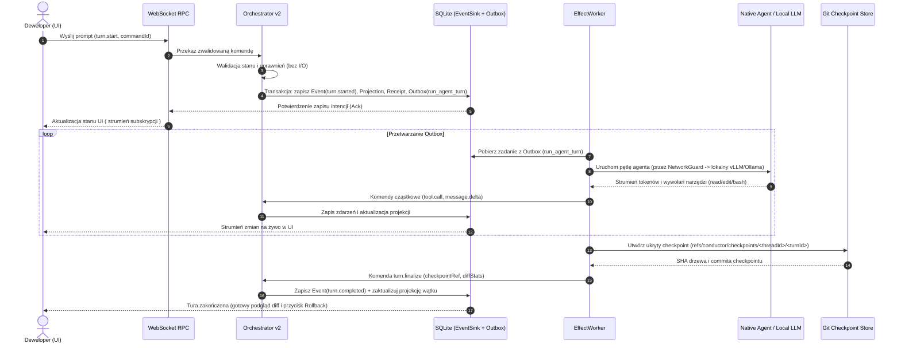

# Plan Stworzenia Systemu Conductor (Enterprise Offline / Intranet Agent Harness)

> **Kontekst:** Realizacja zgłoszenia [tarze07/Conductor#1](https://github.com/tarze07/Conductor/issues/1) — stworzenie rozwiązania wzorowanego na architekturze [pingdotgg/t3code](https://github.com/pingdotgg/t3code), zaprojektowanego od podstaw do pracy **w zamkniętej sieci firmowej (Intranet / Air-Gapped)**, **bez jakichkolwiek połączeń z publicznym internetem**.

---

## 1. Analiza Referencyjna `t3code` vs Wymagania Sieci Firmowej (Zero-Internet)

`t3code` to lekka, wysokowydajna powierzchnia sterowania agentami kodującymi (*agent harness control surface*). Poniższa tabela zestawia kluczowe elementy `t3code` z ich odpowiednikami w systemie **Conductor**:

| Obszar | Rozwiązanie w `pingdotgg/t3code` | Rozwiązanie w `Conductor` (Intranet / Offline) |
| :--- | :--- | :--- |
| **Model wykonania** | Serwer Node.js zarządza plikami, Git i procesami; UI (Web/Desktop/Mobile) łączy się przez typowany WebSocket RPC. | **Zachowane w 100%.** Serwer (`environment`) jest jedynym właścicielem workspace'u i procesów, co pozwala uruchamiać go na stacji roboczej dewelopera lub współdzielonym serwerze w sieci LAN. |
| **Stan i Orkiestracja** | Event-sourced `Orchestrator v2` + transakcyjny zapis do SQLite (`EventSink`, `projections`, `outbox`, `command receipts`). | **Zachowane w 100%.** Zapewnia pełną odporność na utratę połączenia, idempotentność komend oraz natychmiastowe wznawianie sesji bez zewnętrznych baz danych. |
| **Checkpointing i Rollback** | Ukryte referencje Git (`refs/...`) tworzone po każdej turze bez brudzenia gałęzi użytkownika. | **Zachowane w 100%.** Pozwala na atomowy podgląd diffów i cofanie zmian w kodzie równolegle ze stanem rozmowy całkowicie lokalnie. |
| **Providerzy Agentów i LLM** | Subprocesy chmurowych CLI (Claude Code, Codex, Cursor, Grok, Antigravity) wymagające kont SaaS i internetu. | **Przeprojektowane.** Wbudowany **Native Agent Runtime** + adapter **ACP / OpenCode Offline** gadający wyłącznie z wewnętrznymi serwerami LLM (**vLLM, Ollama, LiteLLM Proxy, TGI, llama.cpp**) po wewnętrznym API zgodnym z OpenAI/Anthropic. |
| **Integracje Git (Source Control)** | Głównie GitHub Cloud, GitLab Cloud, Bitbucket Cloud, Cursor Origin. | **Przeprojektowane.** Adaptery dla instancji **On-Premise**: **GitLab Self-Managed**, **Gitea / Forgejo**, **GitHub Enterprise Server (GHES)** oraz **Bitbucket Data Center**. |
| **Dostęp zdalny i Sieć** | `app.t3.codes`, tunel chmurowy `T3 Connect`, publiczny `Tailscale`. | **Przeprojektowane.** Wyłącznie bezpośrednia komunikacja w LAN/VLAN/VPN firmowym (HTTPS/WSS z wewnętrznym PKI / mTLS) lub opcjonalnie self-hosted **Headscale**. |
| **Zasoby UI, Fonty, Telemetria** | Zależności od zewnętrznych skryptów instalacyjnych (`t3.codes`), CDN i logowania OAuth w chmurze. | **Przeprojektowane.** **100% Self-Contained Bundle** (lokalne fonty, gramatyki WASM/Shiki wbudowane w paczkę, zero telemetrii) + twardy **NetworkGuard** blokujący wyjścia poza podsieci firmowe. |
| **Sekrety i Uwierzytelnianie** | Tokeny parowania + DPoP + bilety WebSocket + integracja z 1Password (`@t3tools/secret-provider-onepassword`). | Zachowany model **Scoped Pairing + DPoP + WS Tickets**, rozszerzony o korporacyjne **OIDC / Keycloak / LDAP** oraz **HashiCorp Vault (On-Prem)** i lokalny plik szyfrowany AES-256-GCM. |

### 1.1. Jak to jest zrobione w `pingdotgg/t3code` (Wnioski z analizy kodu źródłowego)

Analiza wewnętrznej dokumentacji (`docs/internals/providers.md`, `adding-a-provider.md`, `remote.md`, `environment-auth.md`) oraz pakietów `packages/*` w repozytorium `t3code` pokazuje dokładnie, które mechanizmy możemy zaadaptować bezpośrednio, a jak skonfigurować je pod sieć firmową:

1. **Architektura Providerów (`Driver` vs `Instance` oraz `ProviderAdapterV2`):**
   - W `t3code` orkiestrator (`Orchestrator v2`) nigdy nie sprawdza nazwy providera (`driver.kind`) — komunikuje się wyłącznie przez znormalizowany interfejs `ProviderAdapterV2` (`@t3tools/provider-core/server/ProviderAdapter.ts`) i odczytuje flagi możliwości z `OrchestrationV2ProviderCapabilities` (`fork`, `rollback`, `steering`, `subagents`) oraz wspierane tryby z `supportedRuntimeModes`.
   - Rozróżniane są dwa pojęcia: **Driver** (typ integracji w `packages/provider-<name>`, eksportujący `./settings`, `./client`, `./server`, `./testing`) oraz **Instance** (konkretna konfiguracja w `providerInstances` posiadająca własną sesję, katalog modeli i poświadczenia, izolowana od zmiennych środowiskowych hosta).
   - `t3code` wspiera dwie ścieżki protokołów:
     - **Współdzielony adapter ACP (`@t3tools/provider-acp` + `@t3tools/provider-acp-registry`):** Uniwersalny adapter protokołu *Agent Client Protocol* (JSON-RPC po `stdio`). W sieci firmowej pozwala on podłączyć dowolnego lokalnego agenta CLI bez dostępu do internetu.
     - **Natywne adaptery (`@t3tools/provider-opencode`, `@t3tools/provider-pi`):** Adapter `opencode` uruchamia lokalny serwer OpenCode (w wersji 2.x jeden serwer per instancja z izolacją wątków przez osobne wpisy MCP `t3-code-<thread>`), a `pi` działa w trybie RPC na lokalnych plikach sesji. Ponieważ zarówno **OpenCode**, jak i **Pi** potrafią łączyć się z lokalnymi serwerami **vLLM / Ollama / LiteLLM Proxy**, w **Conductorze** wykorzystamy ten sam wzorzec `ProviderDriver` + `ProviderAdapterV2`, dodając natywny sterownik **`@conductor/provider-local-llm`** (wbudowany silnik ReAct gadający bezpośrednio z wewnętrznym API OpenAI/Anthropic w LAN, bez wymogu instalowania zewnętrznych binariów CLI).
2. **Wewnętrzny mostek MCP (`Thread-Scoped MCP Bridge`):**
   - Dla każdego wątku serwer `t3code` wystawia lokalny endpoint `/mcp` zabezpieczony wąskim OAuth z PKCE i deklaratywną kontrolą uprawnień (`McpToolAccess.ts`). Dzięki temu agent uruchomiony wewnątrz wątku może wywoływać narzędzia orkiestracji (np. delegowanie subagentów, sprawdzanie stanu PR), a nagłówek `T3-Mode-Limit` gwarantuje, że agent w trybie `Plan` nigdy nie podniesie sobie uprawnień do zapisu.
3. **Rejestr Systemów Kontroli Wersji (`@t3tools/source-control-definitions`):**
   - `t3code` posiada już gotową architekturę rejestru `makeSourceControlDefinitionRegistry` (`packages/source-control-definitions/src/registry.ts`), która oprócz GitHuba obsługuje **`@t3tools/source-control-gitlab`**, **`@t3tools/source-control-forgejo`** (kompatybilny również z Gitea), **`@t3tools/source-control-bitbucket`** oraz **`@t3tools/source-control-azure-devops`**.
   - Każdy adapter definiuje kolejność rozpoznawania adresów URL (`claimChangeRequestUrlsFirst`), rozpoznawania zdalnych repozytoriów (`recognizeRemotesIn` — np. dla niestandardowych domen wewnętrznych typu `gitlab.corp.internal` czy `git.firma.pl`) oraz komendy CLI zamykające PR/MR (`changeRequestCloseCommand` wykorzystywane przez `PullRequestSyncReactor`). W **Conductorze** domyślnie skonfigurujemy ten rejestr pod hosty wewnętrzne (Self-Managed GitLab, Forgejo/Gitea, GHES, Bitbucket Data Center) z obsługą wewnętrznych certyfikatów CA.
4. **Komunikacja Zdalna w LAN, Parowanie i `PeerLinks` (`docs/internals/remote.md` & `environment-auth.md`):**
   - Serwer w trybie bez skonfigurowanego hosta nasłuchuje na interfejsach IPv4, ale **automatycznie zamyka połączenia, jeśli adres peer nie należy do loopback (`127.0.0.0/8`), sieci prywatnej RFC 1918 lub tailnetu**.
   - Klient przechowuje uporządkowaną listę tras (routes) i przed wysłaniem jakichkolwiek poświadczeń sprawdza publiczny deskryptor serwera (`environmentId`), aby upewnić się, że pod adresem IP w sieci LAN nadal odpowiada ten sam serwer.
   - Uwierzytelnianie wykorzystuje tokeny powiązane z kluczem kryptograficznym klienta (**DPoP**) wymieniane po HTTP na krótkotrwałe bilety WebSocket (`WebSocket tickets`), dzięki czemu długowieczne tokeny nigdy nie trafiają do adresów URL gniazd.
   - Mechanizm **`PeerLinks`** pozwala spiąć dwa serwery w sieci LAN (np. stację roboczą programisty i firmowy serwer kompilacji/GPU) za pomocą kodu parowania po `/mcp` (`t3code-peer-link`), umożliwiając delegowanie zadań między maszynami wewnątrz firmy bez udziału jakiejkolwiek chmury.
5. **Testowanie Adapterów przez Deterministyczne Replaye (`@t3tools/provider-testing`):**
   - Zamiast kruchych testów z ręcznie pisanymi ramkami lub testów wymagających płatnych chmurowych API w CI, `t3code` nagrywa rzeczywiste sesje (`record-*-replay-fixture.ts`) i odtwarza je deterministycznie przez prawdziwy `Orchestrator v2` (scenariusze: `simple`, `multi_turn`, `queued_turn`, `turn_interrupt`, `message_steering`, `provider_thread_resume`, `tool_call_*`) przy użyciu `TestClock` z biblioteki `Effect` i drenowalnych workerów (`OrchestrationEffectWorkerV2.drain`). Ten sam rygor testowy przeniesiemy do Conductora.

---

## 2. Architektura Systemu Conductor

### 2.1. Topologia Wdrożenia w Sieci Firmowej (Brak Wyjścia na Internet)



### 2.2. Przepływ Pojedynczej Tury Agenta (Event-Sourced Turn Lifecycle)



---

## 3. Gwarancja „Zero-Internet” (Wielowarstwowa Izolacja Sieciowa)

Aby rozwiązanie spełniało rygorystyczne wymogi bezpieczeństwa sieci korporacyjnych, zakaz łączenia się z internetem nie może opierać się wyłącznie na deklaracji w konfiguracji — musi być wymuszany technicznie na 4 poziomach:

### Poziom 1: Wbudowany Strażnik Sieciowy (`@conductor/network-guard`)
1. **Przechwytywanie na poziomie procesu Node.js:**
   - Nadpisanie globalnego `fetch` (`undici.setGlobalDispatcher`), `http.globalAgent` oraz `https.globalAgent` własnym agentem weryfikującym każde połączenie wychodzące.
2. **Brak zewnętrznego rozwiązywania DNS:**
   - Przed nawiązaniem połączenia adres docelowy jest rozwiązywany przez lokalny resolver systemowy i weryfikowany względem białej listy CIDR.
3. **Polityka domyślnej blokady (Default-Deny dla adresów publicznych):**
   - Domyślnie dozwolone są wyłącznie:
     - `127.0.0.0/8` oraz `::1/128` (Loopback)
     - `10.0.0.0/8`, `172.16.0.0/12`, `192.168.0.0/16`, `fd00::/8` (Sieci prywatne RFC 1918 / RFC 4193)
     - Jawnie zdefiniowane w `conductor.config.json` podsieci i domeny firmowe (np. `*.corp.local`, `llm.internal.company.pl`).
   - Każda próba połączenia z publicznym IP jest natychmiast odrzucana błędem `ERR_EGRESS_BLOCKED_BY_POLICY` i zapisywana w dzienniku audytu.

### Poziom 2: Sanityzacja Procesów Potomnych i Narzędzi (Subprocess Sandbox)
1. **Czyszczenie środowiska dla narzędzi i subagentów:**
   - Automatyczne wstrzykiwanie zmiennych wyłączających telemetrię i aktualizacje we wszystkich uruchamianych narzędziach:
     - `DO_NOT_TRACK=1`, `DISABLE_TELEMETRY=1`, `NEXT_TELEMETRY_DISABLED=1`, `CHECKPOINT_DISABLE=1`, `NPM_CONFIG_OFFLINE=true`, `PIP_NO_INDEX=1`, `HF_HUB_OFFLINE=1`, `TRANSFORMERS_OFFLINE=1`.
2. **Wsparcie dla izolacji systemowej (Linux / macOS / Windows):**
   - Na systemach Linux opcjonalne uruchamianie kroków testowych/budowania agenta w przestrzeni nazw bez sieci (`unshare --net` lub `bubblewrap --unshare-net`), lub z dostępem ograniczonym wyłącznie do lokalnego proxy artefaktów (Nexus/Artifactory).
3. **Własne CA (Corporate PKI):**
   - Natywna obsługa firmowych certyfikatów głównych (`NODE_EXTRA_CA_CERTS` / pakiet certyfikatów w konfiguracji `security.caBundlePath`), co eliminuje błędy TLS przy komunikacji z wewnętrznym GitLabem lub bramką vLLM.

### Poziom 3: 100% Samowystarczalne Assety Frontendowe (Zero External Requests w Przeglądarce)
1. **Nagłówki CSP (Content Security Policy):**
   - Serwer wysyła rygorystyczny nagłówek HTTP:
     `Content-Security-Policy: default-src 'self'; connect-src 'self' ws: wss:; font-src 'self' data:; img-src 'self' data: blob:; style-src 'self' 'unsafe-inline'; script-src 'self' 'wasm-unsafe-eval';`
   - Przeglądarka fizycznie nie może pobrać czcionki z Google Fonts, ikony z zewnętrznego CDN ani wysłać telemetrii (np. Sentry/PostHog).
2. **Lokalne paczki fontów i gramatyk:**
   - Czcionki (`Inter`, `JetBrains Mono`), ikony (`Lucide`) oraz gramatyki kolorowania składni (`Shiki` / `Tree-sitter` WASM) są kompilowane bezpośrednio do katalogu dystrybucyjnego aplikacji.

### Poziom 4: Weryfikacja w CI/CD (`--network=none`)
- Każdy build i zestaw testów integracyjnych uruchamiany jest w kontenerze z całkowicie odciętą siecią (`docker run --network=none`), z lokalnym mockiem serwera OpenAI/vLLM na interfejsie loopback.

---

## 4. Struktura Monorepo i Modułów

Projekt zostanie zorganizowany jako modularne monorepo TypeScript (zarządzane przez `pnpm` z obsługą offline store):

```text
Conductor/
├── apps/
│   ├── server/                   # Serwer Node.js (WS RPC, Orchestrator v2, SQLite, Checkpoints, PTY)
│   ├── web/                      # Aplikacja Web UI (React, Vite, lokalne assety, edytor diffów, terminal)
│   ├── desktop/                  # Powłoka Desktop (Electron/Tauri) bundlująca serwer i Web UI
│   └── cli/                      # Narzędzie wiersza poleceń `conductor` (start serwera, parowanie, diagnostyka)
├── packages/
│   ├── contracts/                # Schematy RPC, komendy, zdarzenia, projekcje, modele uprawnień
│   ├── shared/                   # Narzędzia współdzielone (DrainableWorker, struktury danych, logger)
│   ├── network-guard/            # Warstwa blokady ruchu poza sieć firmową + obsługa firmowego PKI/CA
│   ├── client-runtime/           # Logika połączenia WS, synchronizacja kursorów, kolejka offline klienta
│   ├── agent-core/               # Wbudowany silnik agenta (pętla ReAct, narzędzia FS/Search/PTY, klient MCP)
│   ├── provider-core/            # Interfejs adaptera providera + normalizacja zdarzeń strumieniowych
│   ├── provider-local-llm/       # Adapter dla vLLM, Ollama, LiteLLM, TGI, llama.cpp (OpenAI/Anthropic API)
│   ├── provider-acp/             # Adapter Agent Client Protocol (dla lokalnych agentów CLI / OpenCode)
│   ├── source-control-core/      # Abstrakcja systemu kontroli wersji i Pull/Merge Requestów
│   ├── source-control-gitlab/    # Integracja z GitLab Self-Managed (MR, pipeline status, komentarze)
│   ├── source-control-forgejo/   # Integracja z Gitea / Forgejo / GHES
│   └── secret-store-local/       # Zaszyfrowany magazyn sekretów (AES-256-GCM) + konektor HashiCorp Vault
├── packaging/
│   ├── offline-bundle/           # Skrypty tworzące paczkę instalacyjną `.tar.gz` / `.deb` / `.rpm` bez internetu
│   └── docker/                   # Obrazy Docker (Air-Gapped Ready) + docker-compose z przykładowym vLLM/Ollama
└── docs/
    ├── architecture/             # Dokumentacja architektury i decyzji projektowych
    └── enterprise-deployment/    # Instrukcja wdrożenia w sieci izolowanej (PKI, SSO, Nexus, vLLM)
```

### 4.1. Stos Technologiczny (Technology Stack)

1. **Język, Monorepo i Toolchain:**
   - **Język:** **TypeScript (5.x / 7-preview)** w trybie ścisłym (`strict: true`, zero `any`).
   - **Zarządzanie pakietami i monorepo:** **`pnpm` workspaces** (z obsługą lokalnego *offline store* oraz wewnętrznego rejestru Nexus / Artifactory / Verdaccio).
   - **Testy:** **Vitest** (testy jednostkowe, integracyjne, deterministyczne testy *replay* dla orkiestratora oraz testy przeglądarkowe).
   - **Linter i Formatter:** **Oxlint / Biome** (szybkie natywne narzędzia niewymagające połączenia z siecią).
2. **Backend i Środowisko Wykonawcze (`apps/server`, `apps/cli`):**
   - **Runtime:** **Node.js (22/24 LTS)**.
   - **Architektura usług i kontraktów:**
     - **Wariant A (1:1 jak w `t3code`):** biblioteka **Effect (`effect`, `@effect/schema`, `@effect/rpc`, `@effect/sql-sqlite-node`)** — silnie typowane usługi, kontrolowana współbieżność, `TestClock` oraz walidacja schematów.
     - **Wariant B (lżejsza alternatywa):** czysty **TypeScript + `zod`** z zachowaniem wzorca `Orchestrator v2` + `EventSink` + `EffectWorker`.
   - **Baza danych (Event Store + Projekcje + Outbox):** **SQLite** w trybie **WAL (Write-Ahead Logging)** (`node:sqlite` lub `better-sqlite3`) — jednoplikowa baza `statev2.sqlite` bez zewnętrznych serwerów bazodanowych.
   - **Komunikacja:** **WebSocket (`ws`)** (typowany protokół RPC + strumieniowe subskrypcje zdarzeń) oraz wbudowany serwer HTTP/HTTPS z obsługą **mTLS / wewnętrznego PKI**.
   - **Izolacja sieciowa (`@conductor/network-guard`):** interceptor oparty o **`undici.Dispatcher`** oraz `node:http`/`node:https` `Agent` blokujący ruch spoza RFC 1918 i białej listy hostów firmowych.
   - **Terminale i Git:** **`node-pty`** (sesje pseudoterminala PTY) oraz natywne wywołania **Git plumbing** (`git write-tree`, `git commit-tree`, `git update-ref` na ukrytych referencjach `refs/conductor/checkpoints/*` z izolowanym `GIT_INDEX_FILE`).
3. **Warstwa Agentów i Modeli AI (`packages/agent-core`, `packages/provider-*`):**
   - **Komunikacja z lokalnymi LLM:** natywny klient HTTP/SSE zgodny ze standardem **OpenAI API (`/v1/chat/completions`)** oraz **Anthropic Messages API (`/v1/messages`)** (współpracujący z **vLLM, Ollama, LiteLLM Proxy, SGLang, TGI, llama.cpp**).
   - **Protokoły narzędzi i rozszerzeń:** **MCP (`@modelcontextprotocol/sdk`)** (`stdio` oraz wewnętrzne `Streamable HTTP / SSE`) oraz **ACP (Agent Client Protocol)** (JSON-RPC po `stdio` dla lokalnych agentów CLI jak `OpenCode` czy `Pi`).
4. **Frontend (`apps/web`):**
   - **Framework i Bundler:** **React 19 + Vite**.
   - **UI i Stylowanie:** **Tailwind CSS + komponenty w stylu shadcn/ui (Radix UI)** oraz ikony **Lucide** (wszystko wkompilowane lokalnie).
   - **Terminal i Diff Viewer:** **`@xterm/xterm`** (renderowanie PTY na żywo), **`Shiki`** (gramatyki i motywy spakowane offline jako lokalne moduły JS/WASM) oraz wirtualizowane listy.
   - **Zasoby statyczne:** lokalnie spakowane fonty (`Inter`, `JetBrains Mono` w formacie `.woff2`) + nagłówki **Strict CSP**.
5. **Aplikacja Desktop i Wdrożenie (`apps/desktop`, `packaging/`):**
   - **Desktop:** **Electron** (uruchamiający w tle lokalny proces serwera Node.js i ładujący UI przez schemat `conductor://`) lub opcjonalnie **Tauri**.
   - **Konteneryzacja i dystrybucja Air-Gapped:** **Docker / Podman** (`docker-compose` z wewnętrzną siecią `internal: true`) oraz samowystarczalne paczki instalacyjne (`.deb`, `.rpm`, `.AppImage`, `.msi`, `.tar.gz`).

---

## 5. Szczegółowy Projekt Kluczowych Komponentów

### 5.1. Silnik Orkiestracji (`Orchestrator v2`) i Baza Stanu (`SQLite`)
Wzorując się na najlepszych rozwiązaniach z `t3code`:
- **Separacja decyzji od efektów ubocznych:**
  - `Orchestrator` przyjmuje komendę (np. `thread.create`, `turn.start`, `turn.cancel`, `checkpoint.restore`, `permission.respond`) i czysto funkcyjnie wyznacza listę zdarzeń (`DomainEvent[]`) oraz zadań (`OutboxEffect[]`).
- **Schemat tabel SQLite (`statev2.sqlite` w trybie WAL):**
  - `events(seq INTEGER PRIMARY KEY, stream_id TEXT, stream_version INTEGER, type TEXT, payload_json TEXT, created_at INTEGER)`
  - `command_receipts(command_id TEXT PRIMARY KEY, stream_id TEXT, result_seq INTEGER, created_at INTEGER)`
  - `outbox(effect_id TEXT PRIMARY KEY, type TEXT, payload_json TEXT, status TEXT, attempts INTEGER, created_at INTEGER)`
  - `projections_threads`, `projections_turns`, `projections_projects`, `projections_settings`
- **Odporność na restart i utratę połączenia:**
  - Klient przekazuje przy połączeniu swój ostatni znany numer sekwencyjny (`cursorSeq`). Jeśli brakuje mu tylko ostatnich zdarzeń, serwer przesyła deltę z tabeli `events`; jeśli kursor jest starszy niż okno retencji, klient otrzymuje spójny snapshot z tabeli `projections_*`.

### 5.2. Wbudowany Silnik Agenta (`@conductor/agent-core`) i Lokalni Providerzy LLM
Ponieważ w sieci firmowej nie można polegać na zewnętrznych usługach typu Claude Code Cloud czy OpenAI Codex Cloud, Conductor posiada **własny, wbudowany silnik wykonawczy agenta**:
1. **Zestaw wbudowanych narzędzi (Tools):**
   - `read_file`, `edit_file` (precyzyjna podmiana bloków z walidacją), `write_file`, `list_dir`
   - `search_code` (oparty o lokalny `ripgrep`)
   - `run_terminal_command` (wykonywany w sesji PTY z przechwytywaniem strumienia stdout/stderr i obsługą timeoutów)
   - `git_status`, `git_diff`, `git_log`
   - `delegate_subagent` (uruchamianie pod-agentów badawczych lub implementacyjnych w tym samym workspace'ie)
2. **Obsługa lokalnych serwerów MCP (Model Context Protocol):**
   - Pełne wsparcie dla serwerów MCP uruchamianych lokalnie przez `stdio` lub wewnątrz sieci firmowej przez `SSE / Streamable HTTP` (np. wewnętrzny serwer MCP do Jiry On-Prem, Confluence Server, firmowych baz danych SQL czy wewnętrznej dokumentacji).
3. **Adaptery modeli lokalnych (`@conductor/provider-local-llm`):**
   - Obsługa dowolnego punktu końcowego zgodnego z OpenAI `/v1/chat/completions` oraz Anthropic `/v1/messages` hostowanego w intranecie:
     - **vLLM / SGLang / TGI** (serwery GPU w serwerowni firmowej)
     - **LiteLLM Proxy** (wewnętrzna bramka routująca i bilansująca obciążenie między lokalnymi modelami, np. `Qwen3-Coder-30B`, `DeepSeek-V3/R1`, `Llama-3.3-70B`, `Devstral`)
     - **Ollama / llama.cpp** (modele uruchamiane bezpośrednio na laptopie/stacji roboczej dewelopera, gdy pracuje całkowicie offline).
   - Fallback dla modeli bez natywnego wsparcia `tool_calls`: parser strukturalnych bloków XML/JSON umożliwiający korzystanie z mniejszych modeli lokalnych.

### 5.3. Checkpointing i Zarządzanie Drzewem Roboczym Git
1. **Ukryte referencje Git (`CheckpointStore`):**
   - Przed rozpoczęciem tury oraz po jej zakończeniu serwer tworzy obiekt drzewa (`git write-tree` na tymczasowym pliku indeksu `GIT_INDEX_FILE`), dzięki czemu łapie zarówno pliki śledzone, jak i niezatwierdzone zmiany bez modyfikacji właściwego `.git/index` użytkownika.
   - Zapisuje commit pod ukrytą referencją `refs/conductor/checkpoints/<threadId>/<turnNumber>`.
2. **Atomowy Rollback:**
   - Użytkownik może w dowolnym momencie kliknąć „Przywróć do tego punktu” przy dowolnej wiadomości — serwer przywraca stan plików z wybranego refa i obcina kontekst konwersacji do tego momentu.
3. **Izolacja przez `git worktree`:**
   - Możliwość uruchomienia wielu agentów równolegle nad różnymi zadaniami w tym samym repozytorium dzięki automatycznemu zarządzaniu drzewami roboczymi w `.conductor/worktrees/<threadId>`.

### 5.4. Bezpieczeństwo, Uprawnienia i Audyt Korporacyjny
1. **Trzy tryby uprawnień (`Permission Modes`) per wątek lub projekt:**
   - `plan-only` (Tylko odczyt — agent może przeszukiwać kod i tworzyć plany, nie może edytować plików ani uruchamiać komend).
   - `supervised` (Domyślny — automatyczny odczyt, edycja plików w ramach projektu za potwierdzeniem lub automatycznie z możliwością cofnięcia przez checkpoint, każda komenda terminalowa wymaga jawnego zatwierdzenia w UI).
   - `autonomous-sandbox` (Wykonywanie komend z białej listy np. `pnpm test`, `pytest`, `cargo check` bez pytania, blokada komend destrukcyjnych).
2. **Dziennik Audytu (`AuditLogger`):**
   - Każda interakcja z modelem LLM, każda zmiana pliku i każda uruchomiona komenda systemowa są logowane w formacie JSON Lines (`audit.jsonl`) z podpisem integralności (łańcuch skrótów SHA-256), gotowe do integracji z firmowym SIEM (Splunk / ELK / QRadar).

---

## 6. Plan Realizacji (Harmonogram Fazowy)

### Faza 1: Fundamenty Monorepo, Kontrakty i `NetworkGuard`
- [ ] Inicjalizacja monorepo (`pnpm-workspace.yaml`, `tsconfig.base.json`, konfiguracja budowania i testów `vitest`).
- [ ] Implementacja `@conductor/network-guard`:
  - Blokada połączeń wychodzących poza podsieci prywatne RFC 1918 i skonfigurowaną białą listę (`allowlist`).
  - Obsługa własnych certyfikatów CA (`caBundlePath`) i sanityzacja zmiennych środowiskowych subprocesów.
  - Testy jednostkowe potwierdzające blokadę ruchu do publicznych adresów IP i domen.
- [ ] Implementacja `@conductor/contracts`:
  - Definicje schematów komend, zdarzeń, projekcji, modeli uprawnień oraz komunikatów WebSocket RPC.

### Faza 2: Serwer, `Orchestrator v2`, SQLite `EventSink` i `CheckpointStore`
- [ ] Implementacja warstwy bazodanowej SQLite (`statev2.sqlite`) z tabelami `events`, `projections_*`, `command_receipts` i `outbox`.
- [ ] Implementacja czystego `Orchestrator` oraz `EffectWorker` z gwarancją idempotentności i wznawiania po restarcie.
- [ ] Implementacja `CheckpointStore` opartego o tymczasowy `GIT_INDEX_FILE` i ukryte referencje `refs/conductor/checkpoints/*` (tworzenie snapshotu, generowanie diffów, przywracanie stanu).
- [ ] Implementacja serwera WebSocket RPC z autoryzacją tokenową i subskrypcjami strumieniowymi.

### Faza 3: Wbudowany Silnik Agenta (`agent-core`) i Adapter Lokalnych LLM
- [ ] Implementacja `@conductor/provider-local-llm` obsługującego lokalne endpointy vLLM, Ollama, LiteLLM i llama.cpp (ze strumieniowaniem SSE i obsługą `tool_calls`).
- [ ] Implementacja `@conductor/agent-core`:
  - Pętla wykonawcza ReAct z obsługą budżetu tokenów i anulowania (`AbortSignal`).
  - Wbudowane narzędzia plikowe, wyszukiwarka kodu oraz menedżer sesji PTY z bramką uprawnień (`PermissionGate`).
  - Klient lokalnych serwerów MCP (`stdio` oraz wewnętrzne `HTTP/SSE`).
- [ ] Implementacja `@conductor/provider-acp` dla zewnętrznych, lokalnych narzędzi CLI zgodnych z Agent Client Protocol.

### Faza 4: Interfejs Web UI (100% Offline Bundle) i CLI
- [ ] Stworzenie `@conductor/client-runtime` (zarządzanie połączeniem WebSocket, auto-reconnect, synchronizacja kursorów zdarzeń).
- [ ] Implementacja `apps/web` (React + Vite):
  - Widok wątków projektu, strumieniowy czat z podglądem kroków narzędziowych na żywo.
  - Wbudowany przeglądarkowy podgląd diffów (checkpoint vs bieżące drzewo robocze) oraz przycisk cofania tury.
  - Panel zatwierdzania uprawnień (akceptacja/odrzucanie komend terminalowych) oraz zintegrowany terminal.
  - Lokalny bundling wszystkich czcionek, ikon i gramatyk kolorowania składni + nagłówki CSP blokujące zewnętrzne zasoby.
- [ ] Implementacja `apps/cli` (`conductor start`, `conductor pair`, `conductor doctor --verify-offline`).

### Faza 5: Integracje Korporacyjne On-Premise i Bezpieczeństwo
- [ ] Implementacja adapterów Source Control dla **GitLab Self-Managed** oraz **Gitea / Forgejo** (rozpoznawanie gałęzi, tworzenie i linkowanie Merge/Pull Requestów, odczyt statusów CI).
- [ ] Integracja uwierzytelniania korporacyjnego (OIDC / Keycloak) dla trybu współdzielonego serwera deweloperskiego w intranecie.
- [ ] Implementacja `@conductor/secret-store-local` (zaszyfrowany magazyn lokalny + opcjonalny odczyt sekretów z firmowego HashiCorp Vault).
- [ ] Implementacja dziennika audytu (`AuditLogger`) z łańcuchem skrótów SHA-256.

### Faza 6: Pakietowanie Air-Gapped, Desktop i Weryfikacja E2E
- [ ] Przygotowanie `apps/desktop` (powłoka Electron/Tauri uruchamiająca lokalny serwer Conductor).
- [ ] Stworzenie skryptów pakujących `packaging/offline-bundle` (generowanie samowystarczalnych archiwów instalacyjnych oraz obrazów Docker niewymagających dostępu do sieci podczas instalacji).
- [ ] Przygotowanie `docker-compose.intranet.yml` zestawiającego Conductor + lokalny serwer modeli (Ollama/vLLM) + lokalny Forgejo/GitLab do testów w całkowicie odizolowanej sieci (`internal: true`).
- [ ] Pełny zestaw testów E2E uruchamianych z flagą `--network=none`.

---

## 7. Kryteria Akceptacji Rozwiązania (Definition of Done)

1. **Zero ruchu do internetu:** Uruchomienie `conductor doctor --verify-offline` oraz pełnej sesji pracy z agentem w środowisku z odciętą bramą domyślną (dostępny tylko LAN / loopback) kończy się w 100% sukcesem, bez błędów w konsoli przeglądarki (brak nieudanych żądań do zewnętrznych CDN/API) ani w logach serwera.
2. **Pełna funkcjonalność klasy `t3code`:** Tworzenie projektów i wątków, strumieniowa praca agenta, kontrola uprawnień przed wykonaniem komend, automatyczne checkpointy Git po każdej turze oraz możliwość cofnięcia stanu plików i rozmowy jednym kliknięciem.
3. **Wsparcie dla lokalnych modeli AI:** Potwierdzona kompatybilność z wewnętrznymi instancjami **Ollama**, **vLLM** oraz **LiteLLM Proxy**.
4. **Gotowość do instalacji Air-Gapped:** Możliwość zainstalowania i uruchomienia systemu na czystej maszynie w sieci firmowej wyłącznie z dostarczonego pakietu instalacyjnego / obrazu kontenera.
